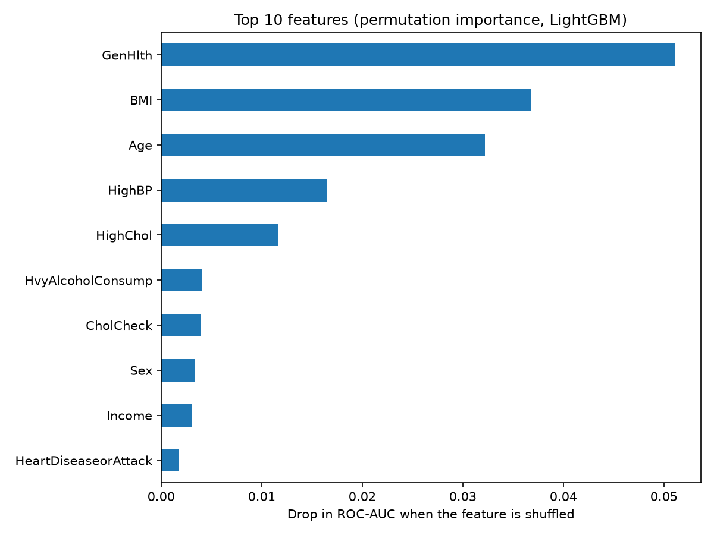
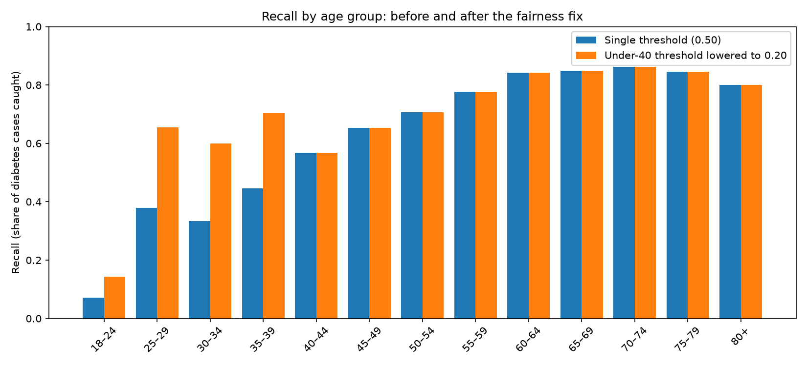

# Diabetes Risk Prediction

A machine learning model that flags people at high risk of diabetes or prediabetes from **CDC health survey answers**, so they can be referred for screening. Includes a model comparison, honest threshold selection, feature importance, and a **fairness analysis** across age, income and sex.

**Live demo:** *coming soon*

## Highlights

- **Final model (LightGBM): catches 79% of diabetes cases on unseen data** (ROC-AUC 0.827), chosen to prioritize recall for screening.
- **Accuracy is a trap here:** a model that always predicts "no diabetes" is 86% accurate but catches 0 cases.
- **Three model families plateau at ROC-AUC 0.82–0.83** (5-fold cross-validated), showing the survey features, not the algorithm, limit performance.
- **Fairness gap found and partly fixed:** recall was only 39% for adults under 40. An age-specific threshold raised it to 64%.

## The problem

About 14% of respondents have diabetes or prediabetes, and many cases go undiagnosed. The goal is a **screening tool**: missing a person with diabetes is costlier than a false alarm (a quick blood test), so the model is tuned for **recall** (share of cases caught) rather than accuracy.

## Data

[CDC Diabetes Health Indicators](https://archive.ics.uci.edu/dataset/891/cdc+diabetes+health+indicators) (BRFSS 2015, UCI Machine Learning Repository): 253,680 respondents, 21 features (health conditions, lifestyle, healthcare access, demographics). Target: diabetes or prediabetes (13.9%).

## Approach

1. **Exploration:** checked missing values, duplicates and class balance; compared diabetes rates across features.
2. **Train/test split:** 80/20, stratified to keep the 13.9% rate in both.
3. **Models:** baseline, logistic regression (default and class-balanced), random forest, LightGBM.
4. **Model comparison:** 5-fold stratified cross-validation (ROC-AUC).
5. **Threshold selection:** chosen on cross-validated training predictions only, then evaluated **once** on the test set.
6. **Interpretation:** permutation feature importance.
7. **Fairness:** performance by age, income and sex, plus an age-specific threshold as a mitigation.

## Results

| Model | CV ROC-AUC | Test ROC-AUC | Recall | Precision | F1 |
|---|---|---|---|---|---|
| Baseline (always "no") | – | 0.500 | 0.000 | – | – |
| Logistic regression (default) | – | 0.819 | 0.158 | 0.517 | 0.242 |
| Logistic regression (balanced) | 0.823 ± 0.001 | 0.820 | 0.761 | 0.311 | 0.441 |
| Random forest (balanced) | 0.828 ± 0.002 | 0.824 | 0.785 | 0.306 | 0.440 |
| **LightGBM (balanced), final** | **0.830 ± 0.002** | **0.827** | **0.790** | 0.307 | **0.442** |

*Recall, precision and F1 at threshold 0.50.*

**Final model on 50,736 unseen test respondents:** caught **5,585 of 7,069** diabetes cases (79%), missed 1,484, with 12,615 false alarms (about 2.3 per case caught).

**Choosing the threshold:** 0.65 maximizes F1 (0.468 on test) but catches only 61% of cases. For screening, 0.50 was chosen to catch about 80%. Lowering the threshold from 0.65 to 0.50 finds 1,248 more cases at the cost of ~4.4 extra screenings per additional case.

## What drives predictions



Self-rated general health, BMI and age dominate, followed by high blood pressure and high cholesterol. Conditions like heart disease, stroke and difficulty walking are strongly linked to diabetes on their own but add little once health rating and age are known, because their information overlaps.

## Fairness

Overall recall (79%) hid large gaps between groups:

| Group | Recall at threshold 0.50 |
|---|---|
| Ages 55+ | 78–86% |
| Ages 25–39 | 33–45% |
| Income under \$15k | ~90% |
| Income \$75k+ | 63% |
| Female / male | 78% / 80% |

The model leans on group-level risk (age, income), so people who don't fit the typical profile, such as young adults with diabetes, are under-detected.

**Mitigation:** lowering the threshold to 0.20 for under-40s (chosen on cross-validated training data) raised their recall from **39% to 64%** (101 → 166 cases caught), while overall recall rose slightly (0.790 → 0.799) and total false alarms grew 7%. The cost is ~13 extra screenings per additional young case found, a trade-off that would be a policy decision in practice.



## Limitations

- **Self-reported survey data:** no lab values (e.g. blood sugar) or family history, which likely caps performance around ROC-AUC 0.83.
- **Correlation, not causation:** for example, heavy drinkers appear to have *less* diabetes, likely because people diagnosed with diabetes reduce drinking.
- **One survey year (2015)** from the US; results may not transfer to other populations.
- **Not a diagnostic tool.**

## Project structure

```
diabetes-risk-prediction/
├── notebooks/
│   ├── 01_exploration.ipynb   # data checks and exploratory analysis
│   └── 02_modeling.ipynb      # models, evaluation, importance, fairness
├── models/
│   ├── lgbm_diabetes.joblib   # trained final model
│   └── model_info.json        # features and thresholds
├── images/                    # charts used in this README
├── data/                      # dataset (not committed; downloaded by notebook 01)
└── requirements.txt
```

## How to run

```bash
git clone https://github.com/anshk4525/diabetes-risk-prediction.git
cd diabetes-risk-prediction
python3 -m venv venv
source venv/bin/activate
pip install -r requirements.txt
jupyter notebook
```

In `01_exploration.ipynb`, uncomment and run the first cell once to download the data. On macOS, LightGBM also needs `brew install libomp`.

## Tools

Python, pandas, NumPy, scikit-learn, LightGBM, matplotlib, seaborn, Jupyter

## Author

**Ansh Kumar**, CS & Mathematics @ Rutgers University

*This project is for learning purposes only and is not medical advice.*